# Screenshots

Screenshots of rustguac v1.12.1 with the default title, logo and **aurora**
theme, OIDC sign-in, Vault-backed connections and session recording. The
[`light/`](light/) folder has the same pages in the built-in **light** theme.

All data is fictional: users are `@example.com`, and hosts use
`*.example.com`, `*.example.net`, `*.example.internal` and the documentation
address ranges (192.0.2.0/24, 198.51.100.0/24, 203.0.113.0/24). The SSH, web
and recording content comes from real sessions to throwaway demo containers.
[`contrib/screenshots`](../contrib/screenshots/) rebuilds the whole set.

## Connections

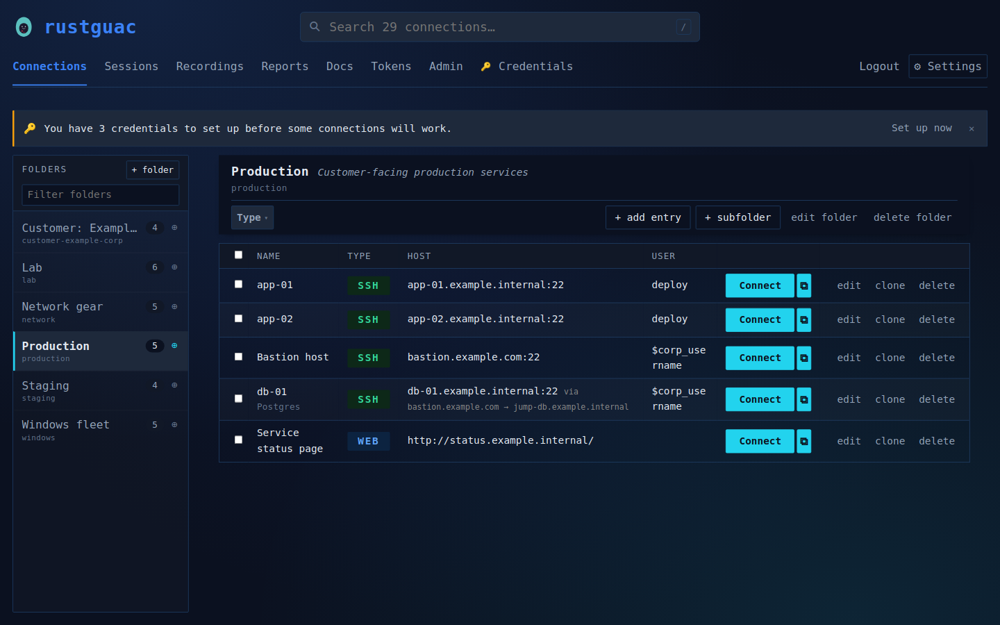

The Connections page. The left sidebar lists the folders with a filter box,
an entry count per folder and a scope marker; the selected folder
(Production) shows its SSH and Web entries with type badges, hosts, users,
**Connect** and pop-out buttons, and edit, clone and delete actions. The
search box at the top searches every connection, and the **Type** filter
narrows the folder's list. A banner at the top says how many of the user's
credential variables still need a value.

## My Credentials

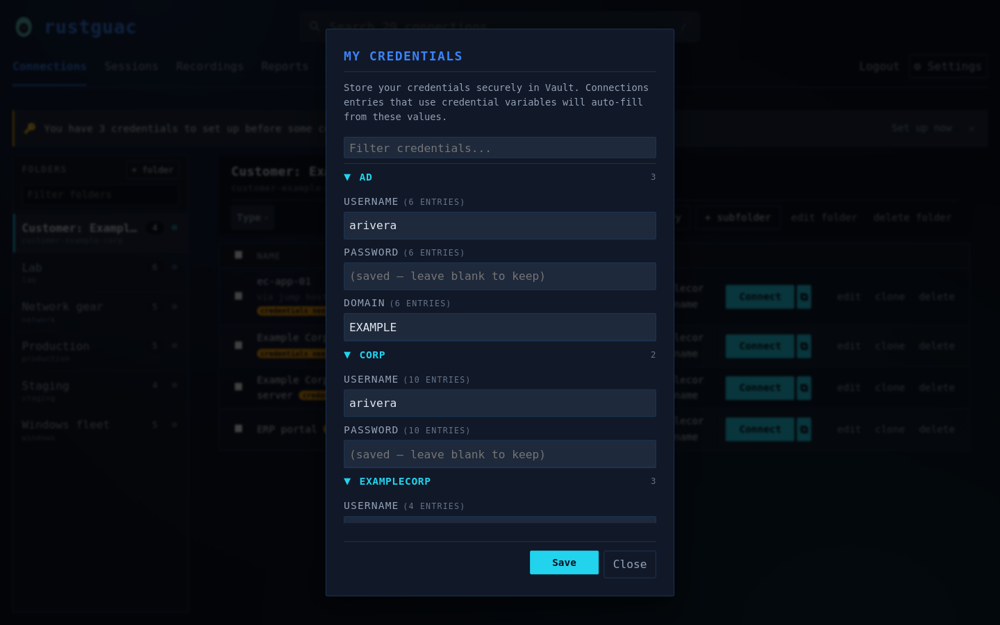

The **My Credentials** dialog, opened from the **Credentials** link. The
credential variables used by the user's entries are grouped by prefix (AD,
CORP, EXAMPLECORP), each showing how many entries use it, with a filter box
for long lists. Saved passwords are never sent back to the browser; they show
as "saved – leave blank to keep". Values are stored per user in Vault.

## RDP Connection Editor

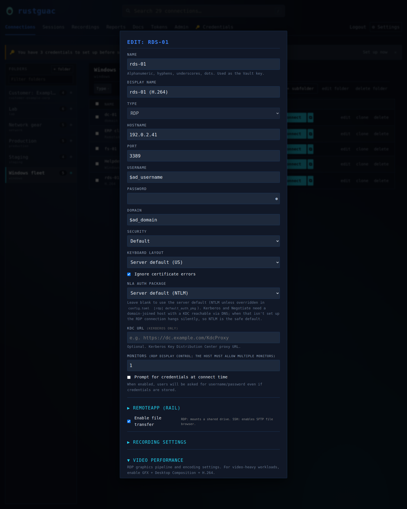

Editing an RDP entry: hostname and port, credential variables for the
username and domain (`$ad_username`, `$ad_domain`), security mode, keyboard
layout, the ignore-certificate option, NLA authentication package, Kerberos
KDC URL, monitor count, prompt-for-credentials, file transfer, and the
collapsible RemoteApp, recording and video performance sections.

## Web Browser Session Editor

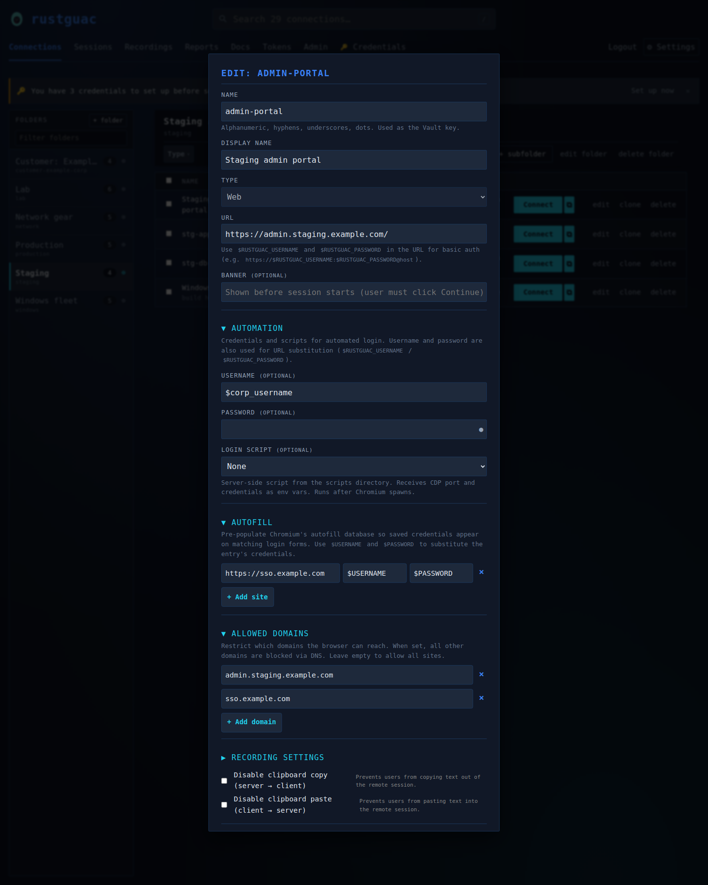

Editing a Web entry, which opens the URL in a Chromium instance on the server
and streams it to the user. The **Automation** section holds the username and
password used for URL substitution and login scripts, **Autofill** fills a
login form on `sso.example.com` with the entry's credentials, and **Allowed
Domains** limits the browser to `admin.staging.example.com` and
`sso.example.com`. Clipboard copy and paste can be disabled per entry.

## VDI Connection Editor

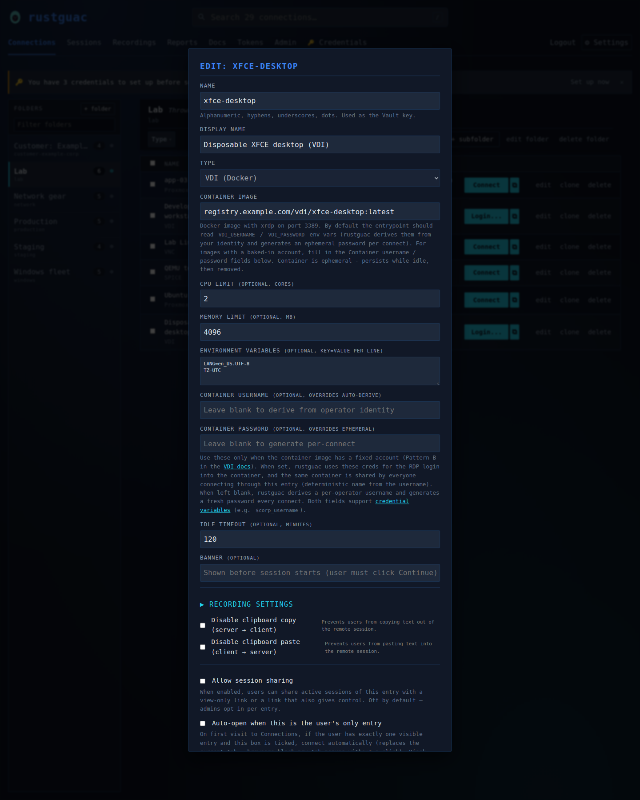

Editing a VDI entry, which starts a Docker desktop container for the user and
connects to it over RDP. The editor sets the container image, CPU and memory
limits, environment variables, an optional fixed container username and
password, the idle timeout, a pre-connect banner, recording and clipboard
options, session sharing, and auto-open when this is the user's only entry.

## SSH Tunnel / Jump Hosts

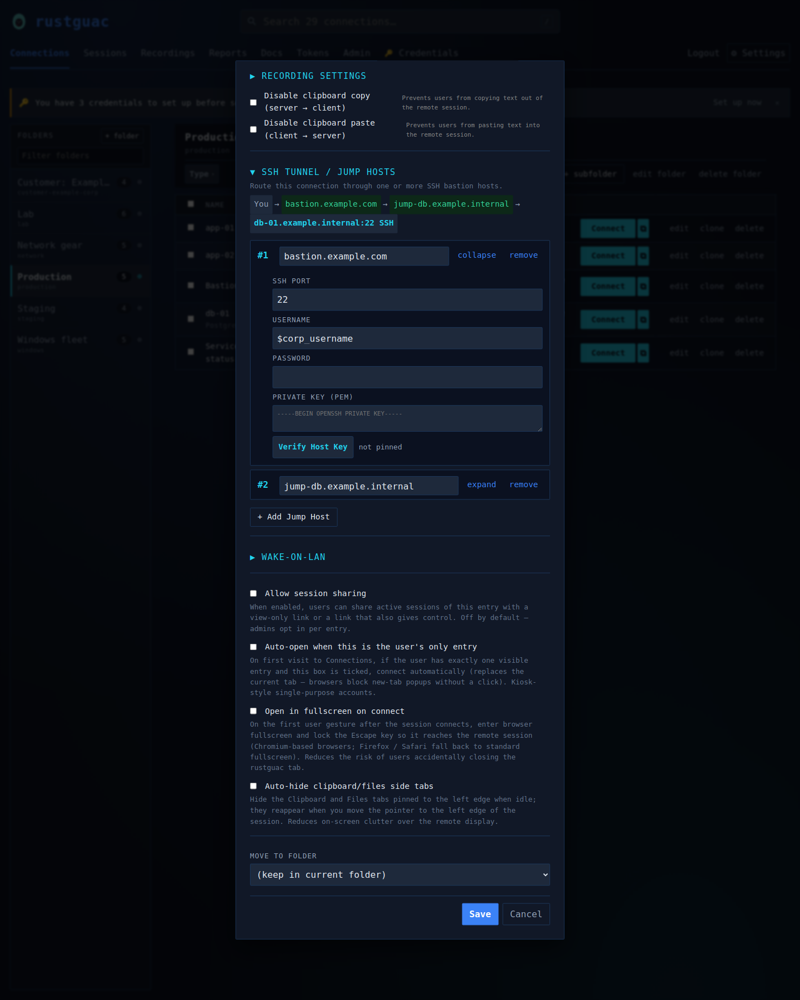

The **SSH Tunnel / Jump Hosts** section of an entry, scrolled to the bottom
of the editor. The route `You → bastion.example.com →
jump-db.example.internal → db-01.example.internal:22` updates as hops are
edited. Each hop is a card with its own port, credentials, private key and a
**Verify Host Key** button for pinning the host key. Below are the
Wake-on-LAN section and the session sharing, auto-open, fullscreen and
side-tab options.

## Sessions

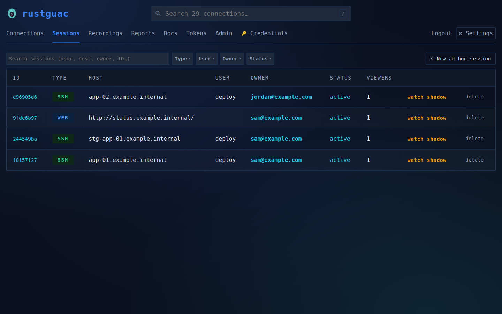

The Sessions page with four active SSH and Web sessions. An admin can
**watch** or **shadow** another user's session, or end it. The search box
and the **Type**, **User**, **Owner** and **Status** filters narrow the
list, and **New ad-hoc session** opens a form for connecting to a host that
has no saved entry.

## Live SSH Session

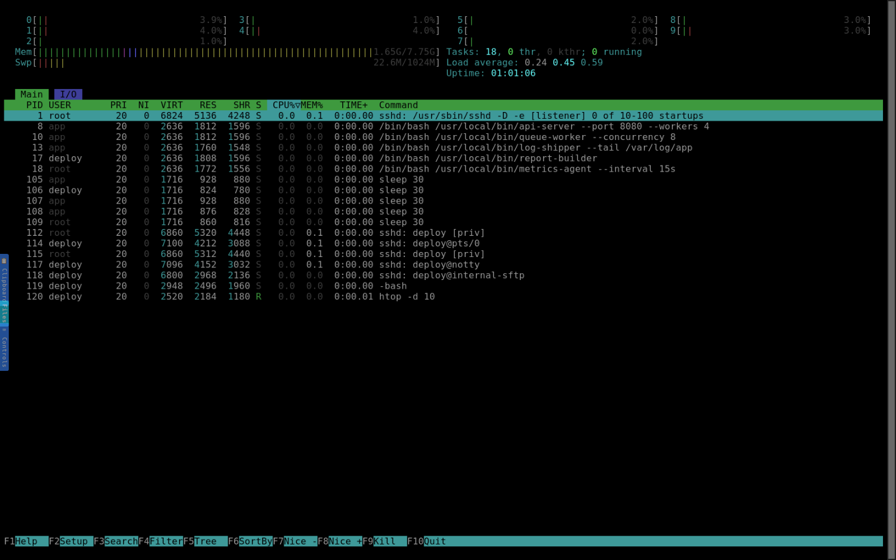

An SSH session in the browser client, running `htop` on a demo host. The
**Clipboard**, **Files** and **Controls** tabs sit on the left edge.

## Live Web Session

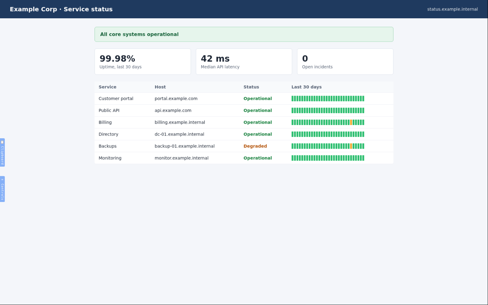

A Web session: a Chromium instance on the server, here showing a fictional
service status page, streamed into the browser. The **Clipboard** and
**Controls** tabs sit on the left edge.

## Session Recording Playback

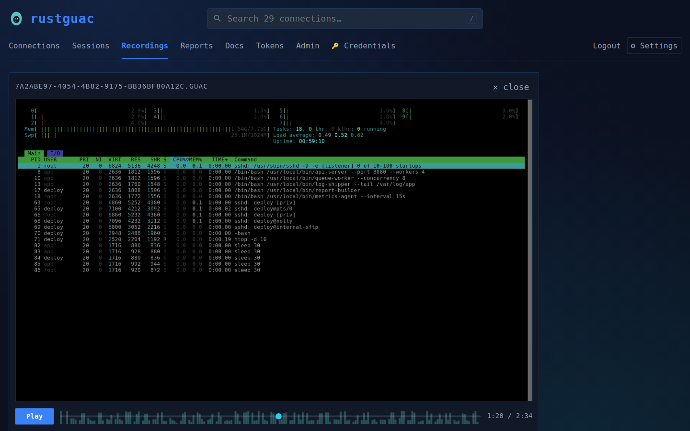

Replaying a recorded SSH session in the browser. Recordings use the
Guacamole `.guac` format. The activity histogram along the seek bar shows
where a recording is busy, so a reviewer can jump straight to it.

## Recordings List

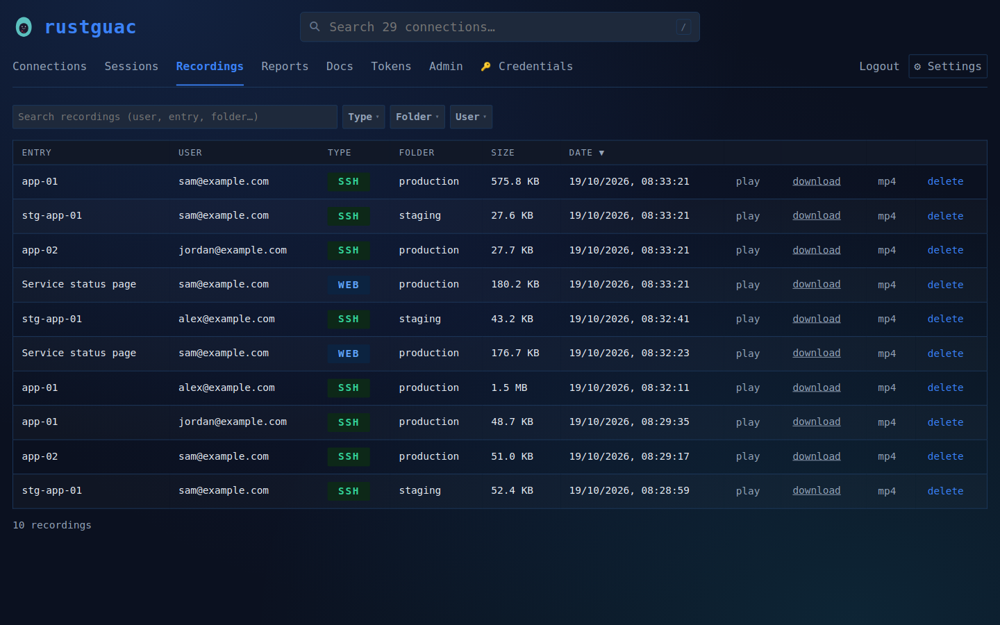

The Recordings page lists recorded sessions by entry, user, type, folder,
size and date, with a search box and **Type**, **Folder** and **User**
filters. Each recording can be played, downloaded as a `.guac` file or as an
MP4 video, or deleted.

## Reports

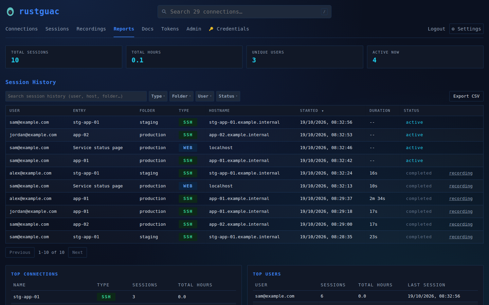

The Reports page: totals for sessions, hours, unique users and active
sessions, above the session history. The history can be searched, filtered
by type, folder, user and status, and exported as CSV, and rows with a
recording link to it.

## Admin

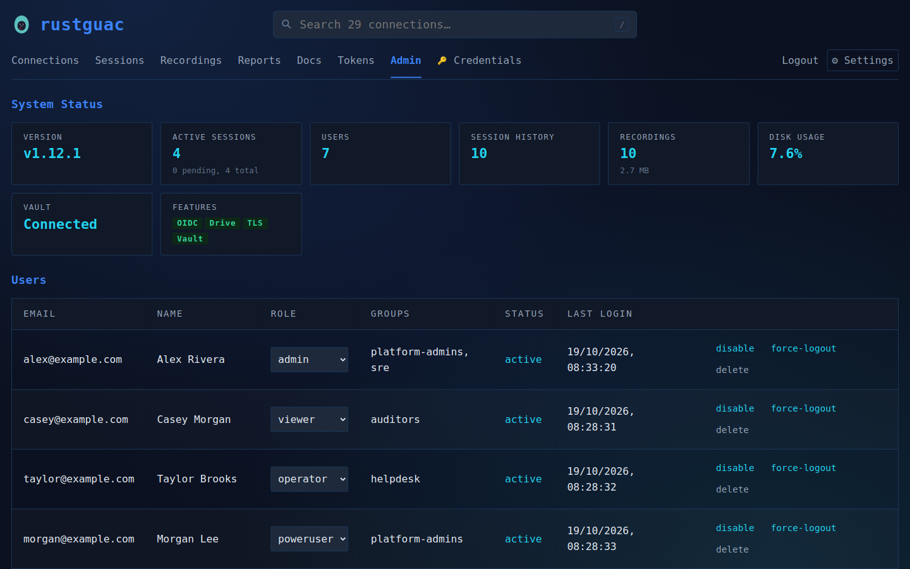

The Admin page. The system status cards show the version, active sessions,
users, session history, recordings, disk usage, Vault status and enabled
features. Below is the users table with each user's role, OIDC groups,
status and last login, and actions to disable, force a logout or delete.

## API Tokens

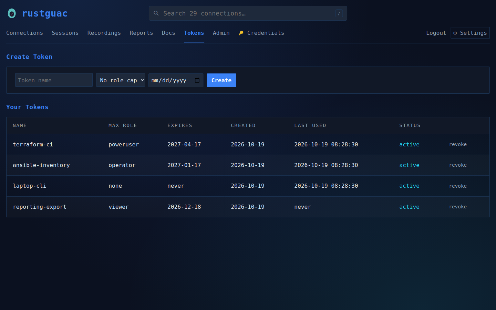

The Tokens page, where users create personal API tokens with an optional
role cap and expiry date. Each token shows its maximum role, expiry, creation
date and last use, and can be revoked. The token value is shown only once,
when it is created.

## Themes

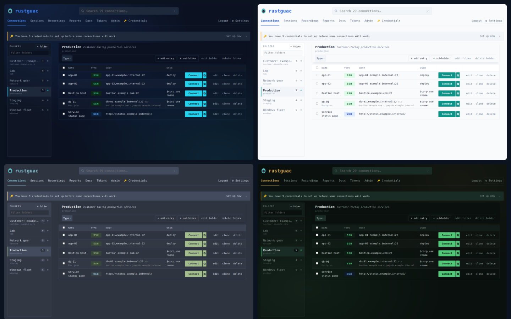

The same Connections page in four of the built-in themes: aurora (the
default), light, nord and jaguar. See [Themes](../docs/themes.md) for the
full list and for adding your own.
